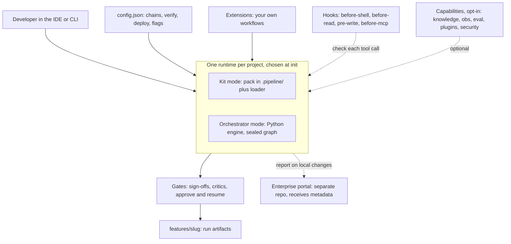

This page is the map. It names each part, says where it lives, and links to the page that explains it. For the reasoning behind the design, read [How it works](/docs/intro/how-it-works) first.

## The parts

## Pack (kit mode)

The pack is a folder of markdown and small scripts. The source is `kit/pipeline/`. `pipeline-kit init` copies it to `<repo>/.pipeline/`.

| Piece | What it does |
|-------|--------------|
| `workflows/` | One JSON file per workflow with the file allowlist for each step |
| `skills/` and `agents/` | The procedure and the brief for each specialist |
| `loader/` | `load_workflow.py` writes `allowed_reads` for the current step. See [Loader](/docs/capabilities/loader) |
| `wiki/` | Pages loaded only when a trigger matches. See [Wiki](/docs/capabilities/wiki) |
| `hooks/` | Policy scripts the IDE runs before and after tool calls |
| `config.json` | Your overlay: chains, verify rules, deploy targets, intake, flags |

The IDE holds only a thin adapter, the `run-workflow` skill. The agent reads `AGENTS.md`, runs the loader through that skill, and works inside the allowlist. Layout on disk: [Pack layout](/docs/reference/pack-layout).

## Orchestrator

The orchestrator is a Python engine. The source is `orchestrator/`, installed as `pipeline_orchestrator`. The chain of steps is code, not markdown. You start a run with `pipeline-kit run`, pass the user ask with `--request`, and pass a human gate with `pipeline-kit approve` and `pipeline-kit resume`. Chat text is not inherited. Commands: [CLI reference](/docs/reference/cli#orchestrator-mode).

`init --mode orchestrator` writes a slim `.pipeline/` with no `agents/`, `skills/`, `loader/` or `workflows/`. The mode needs the `orchestrator` extra and a license; see [Licensing](/docs/reference/licensing).

## Kit mode and orchestrator mode

You pick one per project at `init`. Both use the same first-party workflow names, the same `config.json`, the same hooks and the same `features/{slug}/` output.

| | Kit mode (default) | Orchestrator mode |
|--|--------------------|-------------------|
| Who drives a step | The IDE agent, through `run-workflow` | `pipeline-kit run` |
| Where the chain lives | `.pipeline/workflows/` and `config.json` | The installed engine |
| Model choice | Resolved and recorded, but advisory | Resolved and enforced |

Full comparison and when to choose each: [Two kits](/docs/capabilities/modes).

## Extensions

An extension adds a workflow without forking the kit. The sources are `extensions/kit/` and `extensions/orchestrator/`. In kit mode an extension is a skill plus a workflow JSON plus a `config.json` chain. In orchestrator mode it is a `pipeline_extensions/{name}.py` file in your app. Kit mode never loads `pipeline_extensions/`. Guide: [Extensions](/docs/capabilities/extensions) and [Add a workflow](/docs/guides/add-workflow).

## Capabilities

Capabilities live under `capabilities/` and are off until you turn them on. `init` does not enable them. The CLI group for each is in the [capabilities catalog](/docs/capabilities/overview).

| Capability | What it adds |
|------------|--------------|
| [Knowledge base](/docs/capabilities/knowledge) | A QA overlay built from Graphify output |
| [Plugins](/docs/capabilities/plugins) | Graphify and Archify wrappers |
| [Agent-run observability](/docs/capabilities/observability) | A local ledger of what the agent did, optionally sent to Langfuse |
| Eval | Judges and scores; see [Testing and evaluation](/docs/components/testing) |
| [Feature flags](/docs/capabilities/feature-flags) | Named on/off keys that mirror `config.json` |
| [Agent security](/docs/capabilities/agent-security) | Opt-in detection and response for risky agent actions |

## Hooks and gates

These are two different mechanisms. Both are checks in code or config, not a model reviewing a model.

**Hooks** run on each tool call. Scripts in `.pipeline/hooks/` can deny a shell command, an MCP write, a read of a secret or of a pack file that is not on the active allowlist, or a write to a protected path. `init` merges them into the IDE's hook config for Cursor and Claude Code, and writes `.github/hooks/pipeline-guardrails.json` for GitHub. The list of what each script blocks, and the `PIPELINE_ALLOW_*` overrides, is in the [hooks handbook](/docs/troubleshooting/hooks) and `kit/pipeline/hooks/README.md`. A crashed hook fails open on Cursor and Claude Code (`failClosed` is off); Copilot CLI treats a crash in `preToolUse` as a deny.

**Gates** stop a workflow until a condition holds. Feature-class work has three human sign-offs (requirements, architecture, BA) before any developer starts, plus a critic step with a retry cap. Orchestrator mode exposes the same stops as `approve` and `resume`. See [Planning gates](/docs/capabilities/planning-gates).

Hooks only act where the IDE runs them. They are guardrails for an agent that is trying to follow the process, not a sandbox.

## Control plane, cost visibility, guardrails and gateway

This section says what exists, where, and what does not.

| Topic | Status | Where |
|-------|--------|-------|
| Fleet view of projects, roles, license visibility | Built, in a separate repository. The kit ships only the reporting client, which sends metadata | [Enterprise portal](/docs/capabilities/portal), [what is sent](/docs/reference/portal-protocol) |
| Governance in the open kit: planning gates, licensing | Built | [Governance](/docs/components/governance), [Licensing](/docs/reference/licensing) |
| Guardrails on agent actions | Built: pack hooks always, agent security opt-in in `audit`, `warn` or `block` mode | [Hooks](/docs/troubleshooting/hooks), [Agent security](/docs/capabilities/agent-security) |
| Cost visibility | Partial. Observability records tokens when the IDE sends them. Hooks never record dollar cost; Langfuse can infer it if you define prices there | [Agent-run observability](/docs/capabilities/observability) |
| Context cost | Built. The loader allowlist limits what each step reads | [Loader](/docs/capabilities/loader), [Problems we solve](/docs/intro/problems) |
| Model routing | Kit mode: advisory. The loader writes the chosen model for the agent to use, and IDE chat does not enforce it. Orchestrator mode: enforced through the Cursor SDK | [Two kits](/docs/capabilities/modes), `orchestrator/README.md` |
| Budgets, spend limits, per-team cost reports | **Roadmap.** Not built | None yet |
| AI gateway (a single proxy that all model traffic goes through, with central keys, rate limits and logging) | **Roadmap.** Not built in this repository. Nothing in the kit sits between the agent and the model provider | None yet |

The portal is a separate product with its own repository and documentation. This site does not describe how it works internally. The kit side is limited to the [protocol page](/docs/reference/portal-protocol).

## Where to go next

- [Quick start](/docs/getting-started/quick-start)
- [Components overview](/docs/components/overview)
- [Repository layout](/docs/intro/repo-layout)
- [Two kits](/docs/capabilities/modes)
