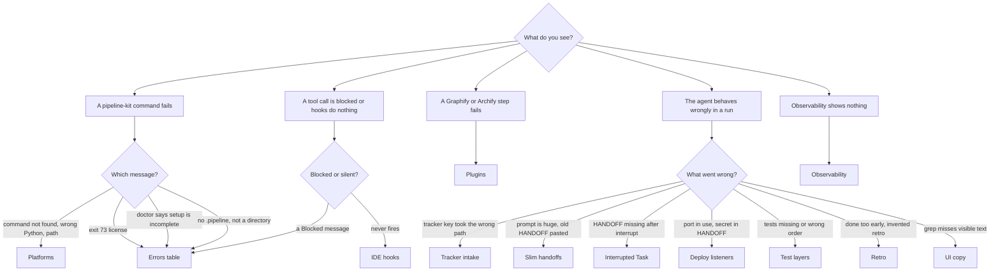

Start from the symptom. Each end box names a page; the table under the diagram links them.

| End box | Page |
|---------|------|
| Platforms | [Platforms](/docs/troubleshooting/platforms) |
| Errors table | [Error messages](/docs/troubleshooting/errors) |
| IDE hooks | [IDE hooks](/docs/troubleshooting/hooks) |
| Plugins | [Graphify and Archify](/docs/troubleshooting/plugins) |
| Tracker intake | [Tracker intake](/docs/troubleshooting/jira-intake) |
| Slim handoffs | [Slim handoffs](/docs/troubleshooting/slim-handoffs) |
| Interrupted Task | [Interrupted Task](/docs/troubleshooting/interrupted-task) |
| Deploy listeners | [Deploy listeners](/docs/troubleshooting/deploy-listeners) |
| Test layers | [Test layers](/docs/troubleshooting/test-layers) |
| Retro | [Retro](/docs/troubleshooting/retro) |
| UI copy | [UI copy split](/docs/troubleshooting/ui-copy) |
| Observability | [Observability](/docs/troubleshooting/observability) |

Nothing matches? Run `pipeline-kit doctor` first. Every `missing` line in its output names one thing to fix. Then read the [FAQ](/docs/troubleshooting/faq).
